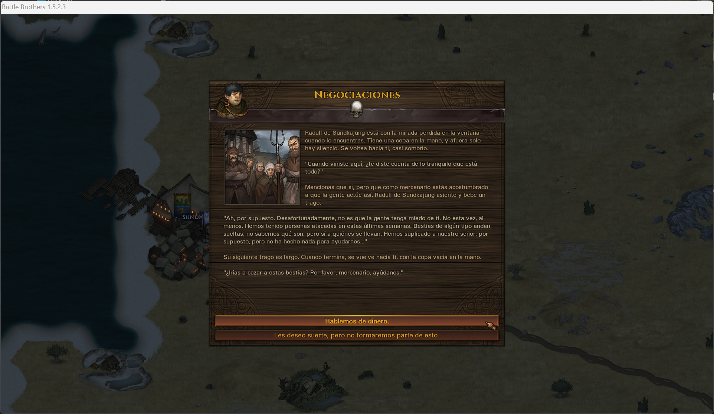

# Battle Brothers en Español

<!-- INSIGNIAS:INICIO (autogenerado por es_pack/tools/update_readme_metrics.py; no editar a mano) -->

<!-- INSIGNIAS:FIN -->

Traducción al español de Battle Brothers, de todas sus expansiones y de [Legends](https://github.com/Battle-Brothers-Legends/Legends-public), el mod más grande del juego: eventos, contratos, combate, interfaz y tooltips, en español neutro para todo el ámbito hispanohablante. No toca ningún archivo del juego, así que un parche no la rompe.

**Novedad en la 5.0.0: Legends, traducido.** Unas 15.800 frases y más de 380.000 palabras del original, dentro del mismo pack, que además pasa a ser un solo archivo.

[Nexus](https://www.nexusmods.com/battlebrothers/mods/640) · [Capturas](docs/CAPTURAS.md) · [Historia del proyecto](docs/HISTORIA.md) · [Problemas conocidos](es_pack/corpus/KNOWN_ISSUES.md) · [Hoja de ruta](ROADMAP.md) · [Colaborar](CONTRIBUTING.md)

## Por qué existe

Battle Brothers es, en buena parte, un juego de leer: los contratos se negocian leyendo y los eventos son pequeños relatos, de los que el juego tiene cientos. La comunidad hispanohablante lleva años con una [traducción completa al castellano](https://www.nexusmods.com/battlebrothers/mods/640), pero sustituía los archivos del juego y cada parche la dejaba fuera de juego hasta que alguien la rehacía.

Este pack toma aquel texto, lo revisa entero, establece una línea editorial homogénea, lo completa y lo monta sobre [Rosetta](https://github.com/Suor/battle-brothers-rosetta). Rosetta es la clave: un framework que traduce los textos mientras juegas, desde la memoria, en lugar de reemplazar archivos. Si un parche trae frases nuevas, esas salen en inglés hasta que se traduzcan, y todo lo demás sigue en español. Cómo se hizo, con sus tropiezos, está en la [historia del proyecto](docs/HISTORIA.md). Desde la 4.0.0 se publica en la [misma página de Nexus](https://www.nexusmods.com/battlebrothers/mods/640) que aquella traducción, como su continuación.

## Qué se traduce

<!-- OBJETIVOS:INICIO (autogenerado por es_pack/tools/update_readme_metrics.py; no editar a mano) -->
| Qué | Estado | Verificada en | Frases cubiertas |
|---|---|---|---|
| Battle Brothers y sus expansiones | Disponible | Battle Brothers 1.5.2.3 | 100 % |
| Legends | Disponible | Legends 19.4.22 | 99 % |
<!-- OBJETIVOS:FIN -->

Las traducciones de mods se van sumando a esta tabla, cada una con su cobertura. La primera es la de [Legends](https://github.com/Battle-Brothers-Legends/Legends-public), desde la 5.0.0: va dentro del mismo pack y solo se carga si Legends está instalado. El pack traduce además la pantalla de ajustes de [MSU](https://github.com/MSUTeam/MSU) y los ajustes de Jimmy's Tooltips (que viene con Legends) y de [Swifter](https://www.nexusmods.com/battlebrothers/mods/542). Lo que viene después está en la [hoja de ruta](ROADMAP.md). La cobertura se mide contra el juego instalado con `measure_coverage.py`: cuenta las frases que el jugador puede leer y descarta las claves internas y las trazas de depuración. Los restos que el extractor toma por texto sin serlo (condiciones de código, trozos de frases que en partida llegan enteras, etcétera) están revisados uno a uno y listados en la propia herramienta.

Ninguna medida estática ve una pantalla cuyo texto no pase por Rosetta. Eso solo lo destapa jugar, y para eso están las [incidencias](https://github.com/backmind/battle-brothers-es/issues/new/choose).

## Instalación

Copia estos seis archivos `.zip` en la carpeta `data` del juego, tal cual, sin descomprimir ni renombrar. Está en `<instalación>\Battle Brothers\data` en GOG y en `<Steam>\steamapps\common\Battle Brothers\data` en Steam.

| | Archivo | Descarga |
|---|---|---|
| 1 | Modding Script Hooks | [Nexus](https://www.nexusmods.com/battlebrothers/mods/42) |
| 2 | Modern Hooks | [Nexus](https://www.nexusmods.com/battlebrothers/mods/685) |
| 3 | MSU, 1.6.0 o superior | [Nexus](https://www.nexusmods.com/battlebrothers/mods/479) |
| 4 | stdlib, 2.5 o superior | [Nexus](https://www.nexusmods.com/battlebrothers/mods/676) |
| 5 | Rosetta, 0.5.0 o superior | [Nexus](https://www.nexusmods.com/battlebrothers/mods/802) |
| 6 | `mod_battle_brothers_es_<versión>.zip`, la traducción, con los menús y pantallas que el juego dibuja en JavaScript | [Nexus](https://www.nexusmods.com/battlebrothers/mods/640?tab=files) o [Releases](https://github.com/backmind/battle-brothers-es/releases/latest) |
| 7 | Opcional: Legends, 19.4.22, con sus dos zips (el mod y sus recursos) | [GitHub](https://github.com/Battle-Brothers-Legends/Legends-public/releases) |

Para jugar con Legends, instálalo según sus instrucciones. Su traducción ya va en el zip del pack y se activa sola cuando Legends está en `data`; sin él, el pack traduce el juego base como siempre.

Arranca el juego; no hay nada que configurar. Para comprobar que ha cargado, entra en **Ajustes de mods** desde el menú principal: en la lista sale «Battle Brothers en Español», con su versión y la del juego contra la que se verificó.

**Para actualizar**, borra el zip de la versión anterior y copia el nuevo. Si vienes de una versión anterior a la 5.0.0, borra también `mod_battle_brothers_es_ui_<versión>.zip`: la interfaz va ahora dentro del zip principal, y el viejo, si se queda, la pisa con la versión antigua. Cuando sale una versión nueva, MSU la anuncia en el menú principal.

**Para desinstalar**, borra ese zip. Las partidas guardadas siguen funcionando.

## Preguntas frecuentes

**¿Sirve para una partida ya empezada?** Sí. El juego guarda dentro de la partida algunos textos que genera al crearlos (biografías de hermanos ya contratados, descripciones de facciones), y esos se quedan en el idioma en que nacieron. Lo que se genere a partir de ahí saldrá en español.

**¿Steam o GOG?** Los dos. La traducción no depende de la tienda, solo de la versión del juego.

**¿Necesito las expansiones?** No. El pack las traduce todas, pero no las pide: si te falta una, sus textos simplemente no aparecen.

**¿Puedo jugar con Legends?** Sí, desde la 5.0.0, verificada en Legends 19.4.22. Instala Legends según sus instrucciones; su traducción va en el zip del pack y se activa sola. Legends, eso sí, cuenta con todas las expansiones del juego y avisa al arrancar si falta alguna: es requisito suyo, no del pack.

**¿Y con otros mods?** Rosetta traduce los textos por coincidencia exacta, así que lo que un mod reutilice del juego base sale en español y lo que añada de su cosecha se queda en inglés. Las traducciones de mods que entran en el pack aparecen en [Qué se traduce](#qué-se-traduce); Legends está traducido desde la 5.0.0. Con otros mods grandes, como Reforged, no se ha probado a fondo; si encuentras algo raro, [cuéntalo](https://github.com/backmind/battle-brothers-es/issues/new/choose).

**¿Por qué seis archivos?** Cinco son el andamiaje que comparten muchos mods del juego, y probablemente ya tengas alguno. El sexto es el pack, con el texto y las pantallas que el juego dibuja en JavaScript. Hasta la 4.0.1 estas iban en un segundo archivo; si vienes de ahí, bórralo al actualizar.

**Ha salido una versión del juego y el pack dice otra. ¿Funciona?** Con total probabilidad: lo que la actualización cambie saldrá en inglés y el resto en español. Los badges de arriba comparan la versión verificada con la última publicada, y en cuanto se verifica la nueva se actualizan.

## El corpus en cifras

Las cifras del juego base y sus expansiones salen del corpus de este repositorio, y la CI comprueba en cada cambio que siguen al día. La traducción de Legends suma otros 15.783 pares, con unas 384.000 palabras del original (408.000 en castellano), frente a las 558.000 del juego base. Entre los dos suman cerca de un millón.

<!-- METRICAS:INICIO (autogenerado por es_pack/tools/update_readme_metrics.py; no editar a mano) -->
| | |
|---|---|
| Pares distribuidos | 16.171 |
| De ellos, patrones con variables | 1.321 |
| De ellos, nacidos fuera de la extracción (composición, MSU, QA) | 969 |
| Pares por id (homógrafos) | 28 |
| En cuarentena de patrones | 0 |
| Sin traducir | 0 |
| Claves internas adjudicadas | 765 |
| Módulos de interfaz traducidos | 39 |
<!-- METRICAS:FIN -->

## Limitaciones conocidas

- **Los objetos legendarios** conservan su nombre en inglés. El juego los compone en marcha juntando dos listas, y Rosetta todavía no sabe traducir esa combinación ([Suor/battle-brothers-rosetta#6](https://github.com/Suor/battle-brothers-rosetta/issues/6)).
- **Los nombres de los mods** en la pantalla de ajustes de mods (Modding Standards & Utilities, Modern Hooks) se dejan en inglés a propósito: son su nombre propio.
- **Las frases nuevas de un parche** salen en inglés hasta que se traduzcan.
- **Un aviso de fuentes en el log** lo trae el propio juego, también sin mods, y es cosmético. Se silencia extrayendo `gfx/fonts/` de `data_001.dat` a `data/gfx/fonts/`.

El detalle está en [KNOWN_ISSUES.md](es_pack/corpus/KNOWN_ISSUES.md).

## Colaborar

Si ves un texto en inglés, una errata o una traducción mejorable, [abre una incidencia](https://github.com/backmind/battle-brothers-es/issues/new/choose) con una captura. No hace falta saber programar ni traer la corrección hecha. Para corregirlo tú, la guía está en [CONTRIBUTING.md](CONTRIBUTING.md), y el manual del mantenedor, con los builds y las herramientas, en [es_pack/README.md](es_pack/README.md).

## Créditos

La traducción es de cinco autores, y se publica también en [su página de Nexus](https://www.nexusmods.com/battlebrothers/mods/640). Si te gusta, déjale allí tu endorse.

- **AMarauder, MagnusLioncaster y Hjensikk**: la traducción original, de la 0.1 a la 3.0.3, con los guiños de Magnus.
- **ElGranFoca**: la adaptación a los parches del juego y la traducción nueva de la 3.0.4 y la 3.0.5.
- **hda (backmind)**: la traducción sobre Rosetta desde la 4.0.0, con la revisión completa del texto, lo que faltaba por traducir, la línea editorial y el mantenimiento, y la traducción integral de Legends en la 5.0.0.
- **Framework**: [Rosetta](https://github.com/Suor/battle-brothers-rosetta), de hackflow (Suor en GitHub).

## Licencias

El repositorio reúne piezas de autores distintos, y cada una conserva la suya:

- **Código propio** (herramientas, hooks del pack, CI): [MIT](LICENSE).
- **Texto de la traducción** (`es_pack/corpus/`): de sus cinco autores, con el permiso expreso de los autores originales. No lleva licencia libre: no se puede reutilizar fuera de este proyecto sin permiso de sus autores, ni usar en mods de pago o con puntos de donación.
- **Traducción de Legends** (`es_pack/corpus/mod_legends_es.nut`): el pack no incluye ningún archivo de Legends; solo lleva sus textos en inglés como claves para encontrar cada traducción. El equipo de Legends confirmó en su Discord que, sin archivos suyos, no hace falta su permiso, y que usar sus textos como claves está bien.
- **Capa de interfaz** (`es_pack/src/ui/`): ficheros del juego, propiedad de Overhype Studios, con los textos traducidos. Se distribuyen como es costumbre en los mods del juego, sin reclamar licencia sobre ellos.
- **Rosetta vendorizado** (`vendor/rosetta/`): de hackflow, bajo su [licencia BSD](vendor/rosetta/LICENSE).

> *English: a Spanish translation of Battle Brothers, all its DLCs and the Legends mod, built on hackflow's [Rosetta](https://github.com/Suor/battle-brothers-rosetta) framework. Install the six zips listed above into the game's `data` folder.*
