# Capturas

Pantallas del juego con Battle Brothers en Español, primero del juego base y después con Legends. Son de ejemplo: el texto exacto puede haber cambiado en versiones posteriores.

# El juego base

## Un contrato

## Un evento

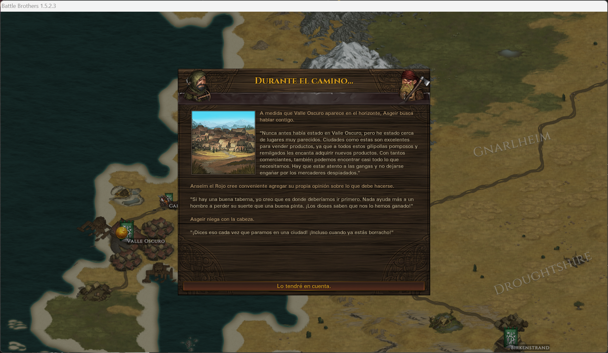

## El combate

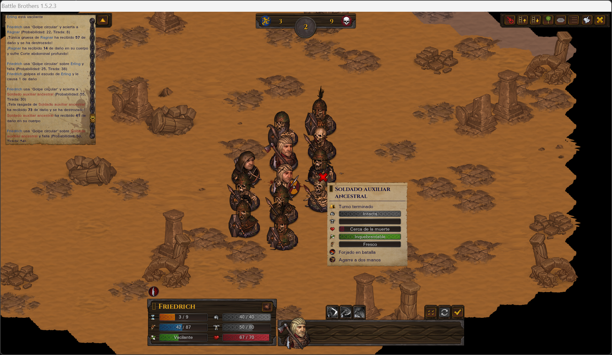

## El mapa del mundo

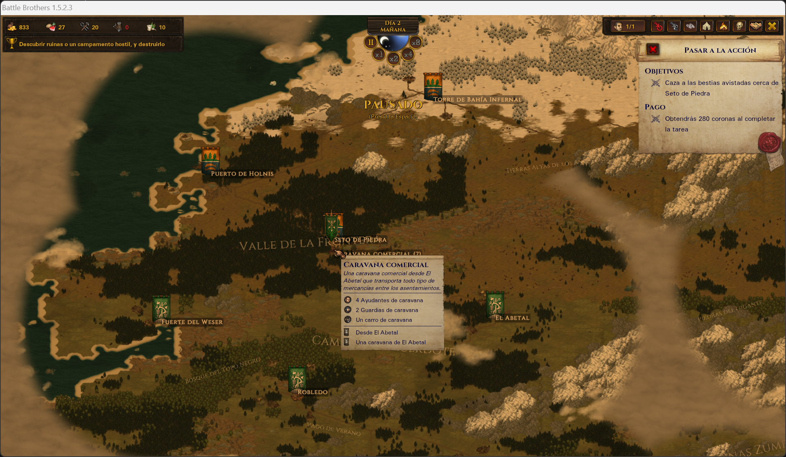

## Un pueblo

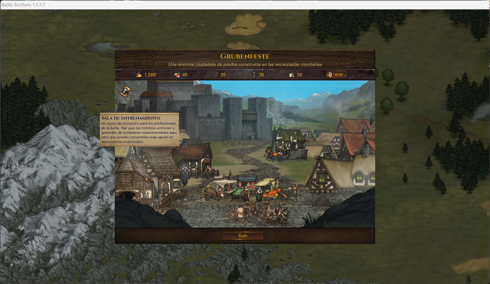

## Las habilidades

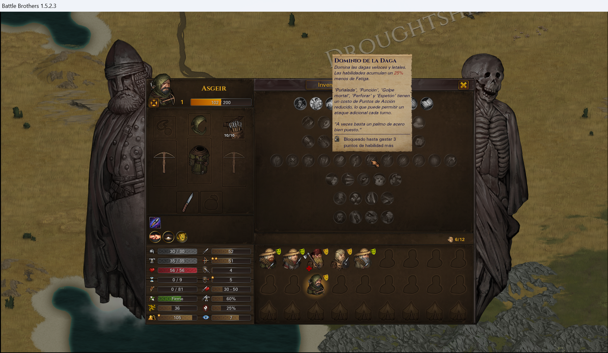

## La victoria

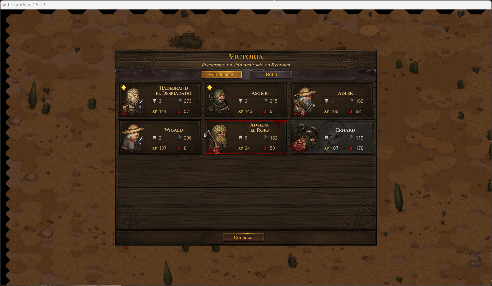

# Con Legends

## El menú principal

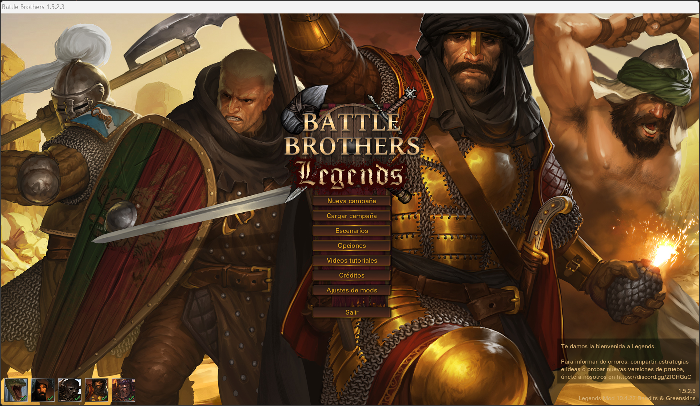

## El campamento

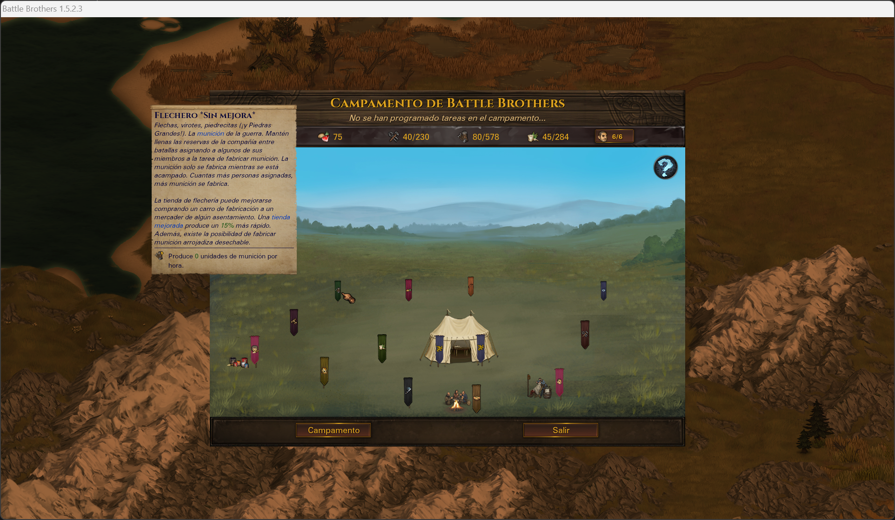

## La ficha de un hermano

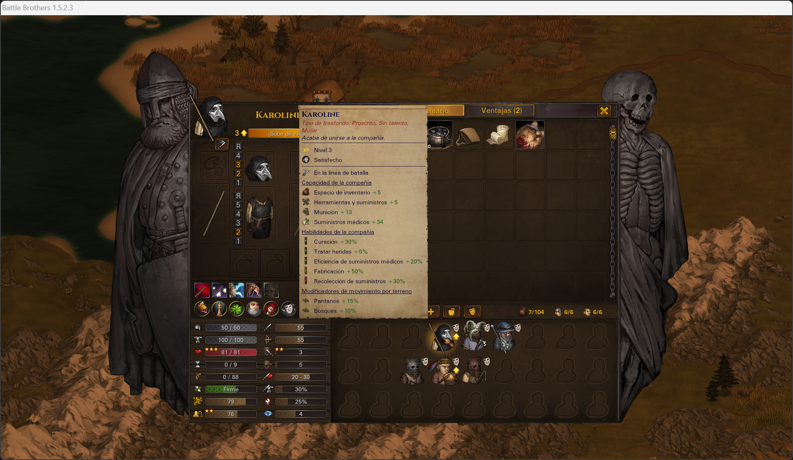

## Una ventaja

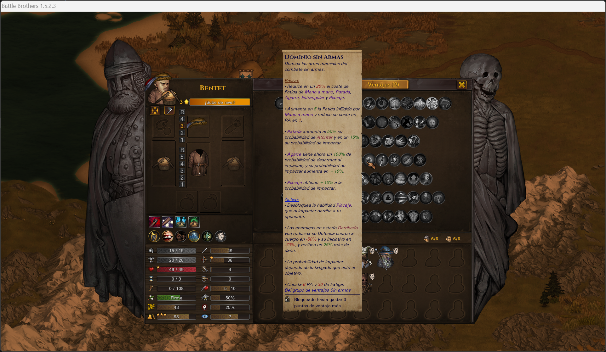

## Un pueblo

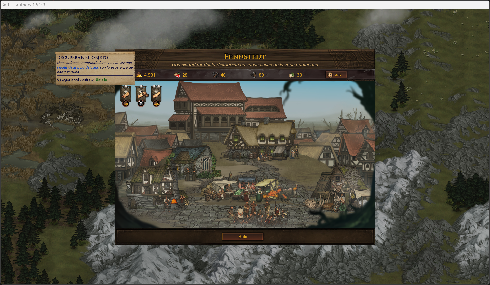

## El combate

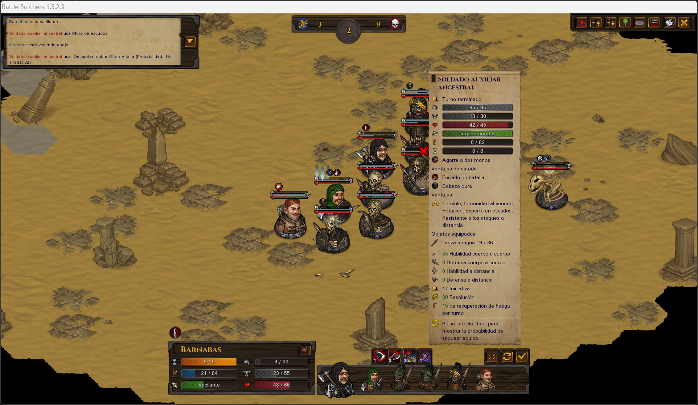
