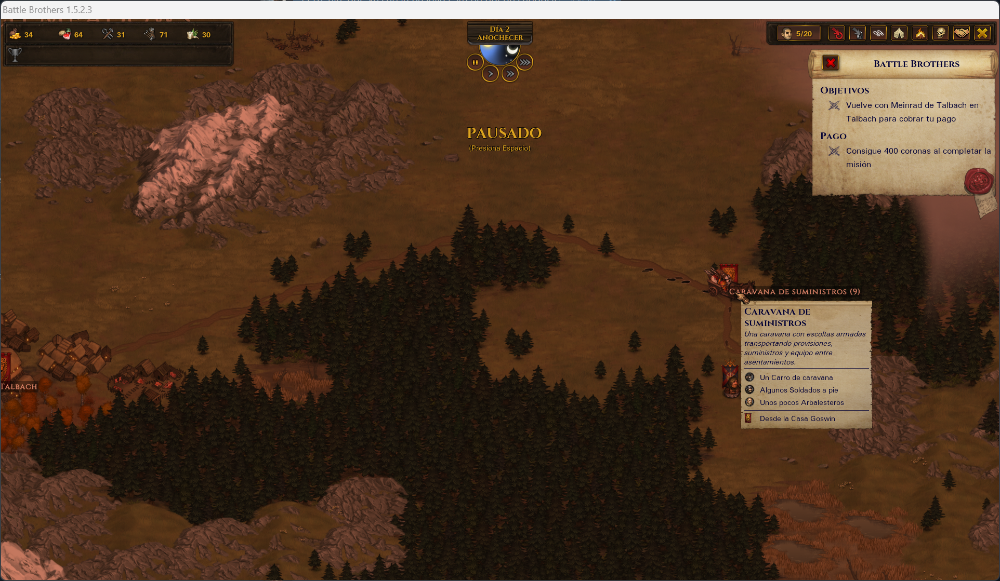

# Capturas

Siete pantallas del juego con Battle Brothers en Español. Son de ejemplo: el texto exacto puede haber cambiado en versiones posteriores.

## Un contrato

## Un evento

## El combate

## El mapa del mundo

## Un pueblo

## Las habilidades

## La victoria

